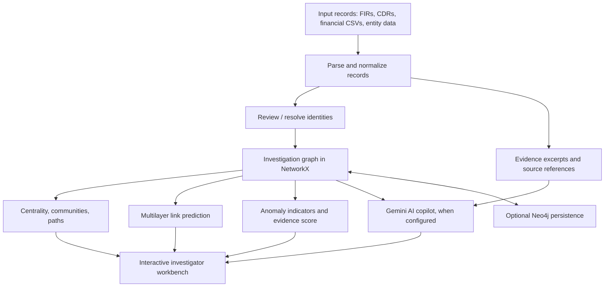

# PSCYPHER — AI-Powered Criminal Network Analysis System

**Smart India Hackathon 2026 · Problem Statement 26189 · NCRB / Ministry of Home Affairs**

PSCYPHER is a Python desktop prototype for exploring relationships across fragmented investigative records. It combines an interactive entity graph, graph analytics, multilayer link-prediction methods, anomaly indicators, FIR document processing, and an evidence-aware AI copilot in one investigator-oriented workbench.

> **AI proposes. Evidence supports. A human investigator verifies.**
>
> PSCYPHER is an investigative decision-support prototype—not a guilt-detection system, a substitute for investigation, or a production law-enforcement records platform.

## Table of contents

- [The problem](#the-problem)
- [What PSCYPHER does](#what-pscypher-does)
- [How it works](#how-it-works)
- [Technology stack](#technology-stack)
- [Requirements](#requirements)
- [Installation](#installation)
- [Configure Gemini AI](#configure-gemini-ai)
- [Run the application](#run-the-application)
- [Quick-start investigation workflow](#quick-start-investigation-workflow)
- [Importing your data](#importing-your-data)
- [Optional Neo4j connection](#optional-neo4j-connection)
- [Synthetic six-case demo](#synthetic-six-case-demo)
- [Project data and local files](#project-data-and-local-files)
- [Current limitations and roadmap](#current-limitations-and-roadmap)
- [Responsible use and privacy](#responsible-use-and-privacy)
- [Troubleshooting](#troubleshooting)

## The problem

Investigative information may be spread across FIRs, call-detail records (CDRs), financial observations, identity registries, and other records. Reviewing each source separately can make it difficult to spot repeated entities, multi-hop connections, bridge actors, or relationships that span several evidence types.

PSCYPHER brings imported observations into a graph so an investigator can inspect connections, explore network structure, test candidate links, and ask focused questions about the evidence currently loaded into the application. Its goal is to help prioritize review—not to automatically decide whether a person committed an offence.

## What PSCYPHER does

### Interactive investigation graph

- Represents people and other entities as nodes, with labelled relationships as edges.
- Supports selecting, searching, dragging, linking, and inspecting graph entities.
- Includes graph focus controls for the top 10, 20, or 40 nodes, as well as the full graph, plus layout and zoom controls.
- Retains multiple observations and their source metadata for a relationship rather than treating every repeated record as a separate, unrelated fact.

### Data ingestion and evidence context

- Imports relationship records from CSV files, including CDR-style and financial-transaction-style files.
- Imports entity records from CSV and entity/relation output from JSON.
- Accepts FIR and investigation documents in PDF and common image formats.
- Uses Gemini for handwriting-aware FIR transcription and structured extraction when configured; local OCR can be used as a fallback when the necessary packages are installed.
- Records source filenames and CSV row numbers where available, helping reviewers trace a relationship back to an input record.
- Provides save/load for an investigation JSON file and export of an investigation report.

### Graph analytics

- **Centrality analysis** to surface highly connected entities and potential brokers or bridges.
- **Community detection** to explore clusters in the current network.
- **Shortest-path exploration** to inspect graph paths between entities.
- **Multilayer link prediction** to rank candidate missing links by combining structural measures, including Common Neighbors, Jaccard similarity, Adamic–Adar, and Personalized PageRank, with a logistic-regression model.
- **Anomaly indicators** across 12 heuristic categories: new-node, new-edge, edge-weight, degree, centrality, community, motif, temporal, geographic, role, attribute, and coordinated-activity anomalies.
- An entity evidence-association score that summarizes analytical signals for review. It is **not** a probability of guilt.

### Evidence-aware AI copilot

When Gemini API access is configured, the copilot can answer investigator questions using a bounded summary of the current graph, available relationship observations, and relevant imported FIR excerpts. Its prompt separates observed information from hypotheses, instructs the model not to invent records, and asks for uncertainty, alternative explanations, and verification steps.

The current default uses one Gemini inference to synthesize three analytical perspectives—network/criminology, temporal patterns, and demographic/context—plus an evidence-evaluator perspective. A source-code setting, `FULL_MULTI_AGENT`, can enable separate sequential calls for these perspectives and the evaluator. These are prompt-defined roles, not independently trained models; the optional calls are sequential, not parallel.

### Separate town identity registry

The **Town Database** menu maintains a local SQLite registry that can be populated with fictional citizens and relationships or imported from CSV. It is separate from the active case graph. FIR identity matches can be reviewed before the matching people are incorporated into an investigation. A name appearing in an FIR does not, by itself, create a relationship edge or imply wrongdoing.

## How it works



The active analytical graph is maintained in **NetworkX**. Neo4j is an optional persistence/query layer that can mirror the graph and reload it later; graph analytics still run through the local NetworkX graph.

## Technology stack

| Area | Technology | Purpose |
|---|---|---|
| Desktop UI | Python, Tkinter / ttk | Interactive investigation workbench |
| Graph model and analysis | NetworkX | Graph storage, centrality, paths, communities, and graph operations |
| Link prediction | NumPy, scikit-learn | Structural features and logistic-regression ranking/evaluation |
| AI copilot and FIR extraction | Google Gemini API (`google-genai`) | Evidence-grounded explanations and handwriting-aware extraction |
| Structured AI output / retries | Pydantic, Tenacity | Validate extraction schemas and retry transient requests |
| Fuzzy matching | TheFuzz, python-Levenshtein | Name-similarity support in identity matching |
| OCR / PDF processing | Tesseract, pytesseract, Pillow, PyMuPDF | Local OCR and PDF/image handling |
| Local registry | SQLite | Persistent town identity/reference data |
| Optional graph persistence | Neo4j Python driver | Mirror and reload the investigation graph |

## Requirements

- Python **3.10 or newer recommended**.
- Tkinter support for your Python installation.
- A working internet connection and a valid Gemini API key for Gemini-powered chat and cloud-assisted extraction.
- Tesseract OCR for local OCR fallback.
- A running Neo4j instance only if you want to use the optional Neo4j menu.

Most Python dependencies are listed below. If the repository contains `requirements-demo.txt`, use it to install the same set:

```text
networkx
numpy
scikit-learn
neo4j
google-genai
pydantic>=2
tenacity
thefuzz
python-Levenshtein
requests
Pillow
pytesseract
PyMuPDF
```

## Installation

### Ubuntu / Debian Linux

Install operating-system dependencies first:

```bash
sudo apt update
sudo apt install python3-venv python3-tk tesseract-ocr
```

From the repository directory, create an isolated Python environment and install the required packages:

```bash
python3 -m venv .venv
source .venv/bin/activate
python -m pip install --upgrade pip
python -m pip install networkx numpy scikit-learn neo4j google-genai "pydantic>=2" tenacity thefuzz python-Levenshtein requests Pillow pytesseract PyMuPDF
```

If the repository has `requirements-demo.txt`, the final installation line can instead be:

```bash
python -m pip install -r requirements-demo.txt
```

### Windows 10 / 11

Install Python from the official Python distribution and ensure Python is available in your terminal. Tkinter is normally included with the standard Windows installer.

In PowerShell, run the following from the repository folder:

```powershell
py -m venv .venv
.\.venv\Scripts\Activate.ps1
python -m pip install --upgrade pip
python -m pip install networkx numpy scikit-learn neo4j google-genai "pydantic>=2" tenacity thefuzz python-Levenshtein requests Pillow pytesseract PyMuPDF
```

For local OCR fallback on Windows, install the Tesseract OCR application separately and make sure its executable is discoverable by `pytesseract` (for example, by adding it to `PATH` or configuring its executable path in Python). Gemini-powered FIR extraction may work without local Tesseract if the cloud path succeeds.

## Configure Gemini AI

Graph operations can be explored without a Gemini key. AI chat and cloud-assisted FIR extraction require valid Gemini API access.

Set the `GEMINI_API_KEY` environment variable before starting the app. **Do not commit API keys to GitHub.**

Ubuntu / Linux:

```bash
export GEMINI_API_KEY="YOUR_GEMINI_API_KEY"
python PSCYPHER.py
```

Windows PowerShell:

```powershell
$env:GEMINI_API_KEY = "YOUR_GEMINI_API_KEY"
python PSCYPHER.py
```

The source also contains the `GEMINI_API_KEY` and `GEMINI_MODEL_DEFAULT` configuration constants near the AI setup. For safer sharing, leave the key constant empty and use the environment variable. The configured default model is defined in the source and can be changed there if your Gemini account/API supports another model.

### Data-sharing notice

When the AI copilot or cloud FIR processing is used, selected graph context and/or the uploaded document text or image may be sent to Google Gemini for processing. Use synthetic data for public demos. Do not upload real, sensitive, confidential, or legally restricted case records unless you have explicit authorization and have reviewed the applicable agency policy, contractual terms, and data-protection requirements.

## Run the application

From the repository directory, activate the virtual environment and launch the application:

```bash
python PSCYPHER.py
```

If startup fails with a Pydantic-related error, confirm that the same Python environment used to run `PSCYPHER.py` has Pydantic v2 installed:

```bash
python -c "from pydantic import BaseModel, Field; print('Pydantic OK')"
```

If your downloaded source file has a different name or is located in another directory, update the launch command accordingly.

## Quick-start investigation workflow

1. **Start with a clean investigation.** Keep the demo focused; clear or load an investigation deliberately rather than mixing unrelated records.
2. **Load reference identities if needed.** Open **Town Database → Import Town Citizens (CSV)** to load a synthetic/local identity registry. The town registry is not the case graph.
3. **Upload an FIR.** Choose **File → Upload FIR / Investigation Document…** or use the FIR button. Review the extracted entities and confirm identity matches when prompted.
4. **Import relationship data.** Use **File → Import Relationships (CSV)** and select CDR, financial, or other relationship files. Multiple files can be selected in one import operation.
5. **Inspect the network.** Run **Analysis → Calculate Centrality**, **Detect Communities**, **Find Shortest Path**, **Run Link Prediction (Multilayer)**, and **Detect 12 Anomaly Types** as appropriate for the available data.
6. **Review evidence for a selected entity.** Select a node, inspect its properties and source references, and use **Explain Score** or the AI copilot if Gemini is configured.
7. **Save and report.** Use **File → Save Investigation (JSON)** and **File → Export Investigation Report** to keep an investigation snapshot or share a review report as permitted by your data-handling policy.

## Importing your data

PSCYPHER accepts flexible CSV structures, but **consistent identifiers and unambiguous endpoints are important**. Keep an untouched copy of each source file and avoid changing source values during import preparation.

### Relationship CSV

The importer tries to recognize these endpoint column pairs:

| Source column | Target column | Typical use |
|---|---|---|
| `calling person` | `called person` | CDR-style call observations |
| `sender` | `recipient` | Financial or transfer observations |
| `source` | `target` | Generic edge list |
| `from` | `to` | Generic edge list |

If none of these pairs exists, it attempts to identify two columns whose values match node IDs or labels already present in the graph. Endpoint names must resolve to graph entities or unique identities in the town registry; unresolved or ambiguous rows may be skipped and summarized.

An optional `relation`, `relationship`, `rel_type`, `edge_type`, or `type` column can define the relationship label. Otherwise, the importer may infer a label from the filename—for example, a filename containing `cdr`, `call`, or `phone` can map to `Calls`, while `financial`, `transaction`, `payment`, or `money` can map to `Transactions`.

Numeric columns such as `duration_sec`, `call_duration`, `amount_inr`, `amount`, or `transaction_amount` can be used to derive normalized relationship weights. Keep original values and units in the CSV; the normalized weight is an analytical convenience, not a replacement for source values.

Example:

```csv
calling person,called person,timestamp,duration_sec,record_id
Aarav Iyer,Rohan Mehta,2026-01-12 10:30:00,185,CDR-001
Rohan Mehta,Aarav Iyer,2026-01-13 16:05:00,42,CDR-002
```

### Entity CSV

Use at least one column whose header contains `id` (such as `id`, `node_id`, `person_id`, or `account_id`). Optional `type` or `entity_type` values can indicate the entity type. Other columns are retained as properties.

```csv
person_id,name,type,city
P001,Aarav Iyer,Person,Nandipur
P002,Rohan Mehta,Person,Nandipur
```

### NER / ML output JSON

Choose **File → Import NER / ML Output (JSON)**. The current importer expects an `entities` array and a `relations` array. Predicted relations are marked as machine-predicted and displayed as dashed links until an analyst verifies them.

```json
{
  "entities": [
    {"name": "Aarav Iyer", "type": "Person"},
    {"name": "Phone 555-0101", "type": "Phone Number"}
  ],
  "relations": [
    {
      "from": "Aarav Iyer",
      "from_type": "Person",
      "to": "Phone 555-0101",
      "to_type": "Phone Number",
      "label": "Uses",
      "confidence": 0.82
    }
  ]
}
```

The JSON importer uses the current expected field names; other NER output schemas may need a small adapter before import.

## Optional Neo4j connection

Neo4j integration is optional. The application can run graph analysis locally through NetworkX without a Neo4j server.

1. Start a Neo4j instance and create or select a database.
2. In PSCYPHER, open **Neo4j → Connect to Neo4j…**.
3. Enter the connection URI, username, password, and database name.
4. Use **Push Current Graph to Neo4j** to mirror the current graph or **Load Graph from Neo4j** to replace the active graph with stored data.

**Caution:** the Neo4j menu includes a database-clearing action. Use a dedicated development database, verify the selected connection, and never test destructive actions against a production or shared database.

## Synthetic six-case demo

If you have the companion archive `PSCYPHER_Six_Case_Investigation_Demo.zip`, it contains **fictional training material**, including six synthetic FIR PDFs, a 10,000-person synthetic town registry, CDR-style observations, and financial observations.

A suggested walkthrough is:

1. Extract the archive to a working folder.
2. In **Town Database → Import Town Citizens (CSV)**, select `town_10000_citizens.csv`.
3. Start a fresh investigation and upload `FIR_01_SYNTHETIC_TRAINING.pdf` through `FIR_06_SYNTHETIC_TRAINING.pdf` in order. Review each suggested identity match.
4. Choose **File → Import Relationships (CSV)** and select `cdr_1300_FIR_SCOPED.csv` and `financial_780_FIR_SCOPED.csv`.
5. Calculate centrality, focus the graph on the top 10 or 20 entities, detect communities/anomalies, and run multilayer link prediction.
6. Select a relevant entity and ask the copilot a specific evidence-checking question, such as: *“Compare the uploaded FIRs and identify the strongest cross-case connections supported by both communication and financial observations. Cite source files/rows where available, distinguish observations from hypotheses, and state what should be independently verified.”*

All names, records, and events in that companion package are synthetic. Treat any patterns found in it as demonstration outputs, not findings about real people. Keep internal evaluation/ground-truth material separate from the public demonstration.

## Project data and local files

- `pscypher_town.sqlite3` is created beside `PSCYPHER.py` and stores the local town registry and town relationships. Back it up if you need to preserve that registry; do not commit real personal data to Git.
- FIR processing writes a transcription text file beside the selected source document and may create a local extraction cache. Review your input folder before sharing it.
- Investigation JSON files and exported reports are created at the locations selected by the user.
- Keep original source data read-only and preserve a separate record of any transformations used for import.

## Current limitations and roadmap

PSCYPHER is a prototype. Current capabilities should not be confused with proposed production integrations.

### Implemented in the current prototype

- Tkinter graph workbench with NetworkX graph analysis.
- CSV/JSON imports, FIR document processing, investigation JSON save/load, and report export.
- Centrality, community detection, path exploration, multilayer link prediction, and heuristic anomaly indicators.
- Gemini-supported, evidence-aware copilot and FIR extraction when API access is configured.
- Local SQLite town registry and optional Neo4j graph persistence.

### Not implemented as production integrations

- Direct integration with CCTNS, ICJS, NATGRID, telecom providers, bank systems, or other restricted government systems.
- A permissioned blockchain ledger for evidence provenance.
- Automated generation or legal certification of a Bharatiya Sakshya Adhiniyam (BSA) Section 63 certificate.
- Production-grade identity/access management, deployment hardening, multi-user audit governance, or operational security controls.
- An isolated hypothesis-simulation environment and fully independent, parallel AI agents.

These are possible future directions, not claims about the current application. Hashes, AI-generated summaries, anomaly flags, and link-prediction scores do not by themselves establish the authenticity of a source record or the truth of a hypothesis.

## Responsible use and privacy

PSCYPHER is intended for education, prototyping, and controlled demonstrations using synthetic or explicitly authorized data.

- **No presumption of guilt:** network position, centrality, anomaly scores, AI explanations, and candidate-link rankings are leads for review, not findings of criminal responsibility.
- **Verify identities:** common names, aliases, incomplete records, and inconsistent identifiers can produce false matches. Review identity-resolution prompts and source records before accepting a match.
- **Separate fact from inference:** an FIR mention may describe a complainant, witness, victim, or another role. Mention alone is not proof of involvement.
- **Check original evidence:** validate important findings against authoritative source material, timestamps, transaction records, telecom evidence, witness statements, and reasonable alternative explanations.
- **Protect data:** restrict access to source documents, exports, local databases, API credentials, and backups. Never commit secrets or sensitive case records to a public repository.
- **Understand cloud processing:** when Gemini is enabled, the application sends relevant content to the external API. Follow your organization’s data-processing and authorization rules before using non-synthetic information.
- **Human decision-making remains essential:** this application must not be used as the sole basis for arrest, surveillance, prosecution, or any adverse decision.

## Troubleshooting

### `ModuleNotFoundError` or imports fail

Activate the same virtual environment used during installation, then install the packages again. Check the interpreter path with `which python` on Linux or `where.exe python` in Windows PowerShell.

```bash
python -m pip install --upgrade pip
python -c "import networkx, numpy, sklearn; from pydantic import BaseModel, Field; print('Core imports OK')"
```

### `Tesseract is not installed` or local OCR fails

Install the Tesseract system application, not only the Python `pytesseract` package. On Ubuntu/Debian, use `sudo apt install tesseract-ocr`. On Windows, install Tesseract separately and ensure the executable can be found. A scanned PDF may also require PyMuPDF to render pages.

### Gemini unavailable or AI Copilot errors

Confirm `GEMINI_API_KEY` is set in the terminal **before** launching PSCYPHER, check network access and API permissions, and verify that the configured model is available to your account. Graph analytics do not require Gemini; AI chat and cloud extraction do.

### Relationship CSV rows are skipped

Check that the file contains recognized endpoint columns or values that match existing node IDs/labels. For town-registry matching, verify that the imported identities are unique and correctly spelled. Review the import summary for unresolved identities, missing endpoints, or self-links.

### Neo4j connection fails

Confirm that Neo4j is running, the URI and database are correct, the credentials are valid, and the configured network port is reachable. The Neo4j driver is optional; you can still use the local graph without it.

---

## Project status

PSCYPHER is actively being developed as a Smart India Hackathon prototype. Contributions, issues, and feedback should focus on reproducible examples, source traceability, false-positive reduction, usability, and responsible evaluation on appropriately governed data.
